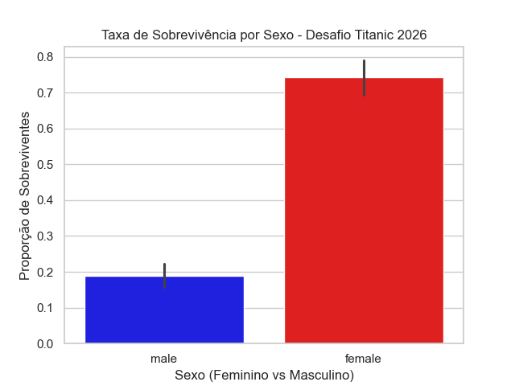
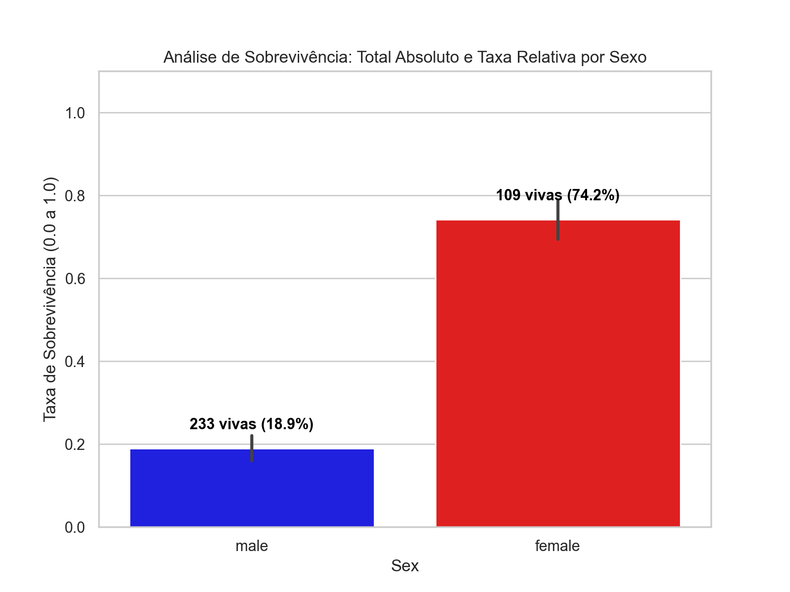
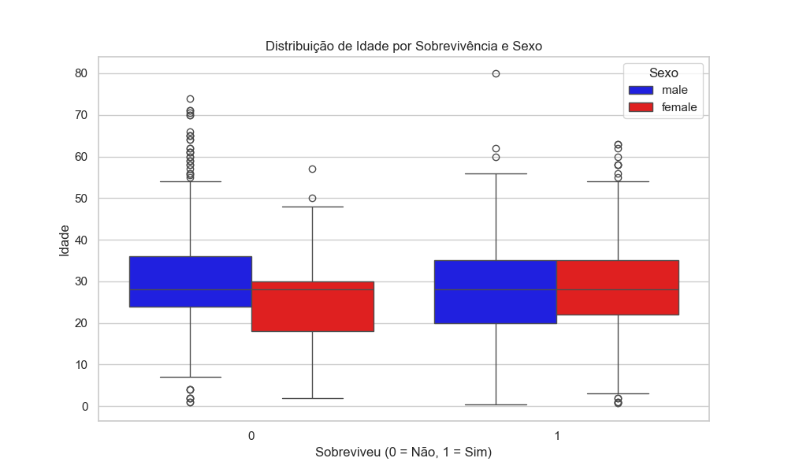
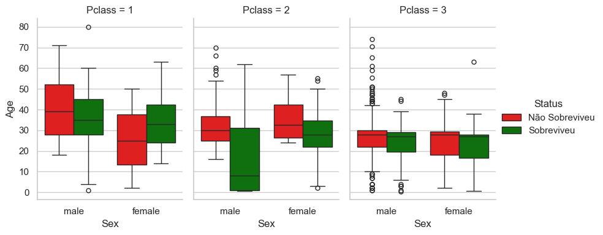

## Documentação do Projeto: Titanic SCTec
## Análise Exploratória de Dados (AED) 

Esta é uma atividade sugerida para execução de atividade prática do tipo desafio para o curso de Introdução ao Data Science ministrado pelo LAB365 sob auspícios do programa SCTec, parceria SENAI. A atividade tem como objetivo realizar uma Análise Exploratória de Dados (AED) buscando identificar padrões de sobrevivência. 

Para tanto, utilizando os dados sugeridos (`titanic_dataset.csv`), desenvolvi um pipeline para observar os passos necessários e atingir os objetivos solicitados no projeto. A ideia é a de coletar, transformar e carregar os dados e construir, testar e obter resultados para análise embasados em avaliações estatísticas. 

Primeiramente, foi necessário definir as fases do projeto, o que facilitaria na definição dos objetivos e na localização dos códigos:

* **Fase 1** - Tratamento dos dados e construindo Tabela 1 e Tabela 2
* **Fase 2** - Construindo a Tabela 3 e Tabela 4, e `graf1` e `graf1a` 
* **Fase 3** - Construindo a Tabela 5 e `graf2`
* **Fase 4** - Construindo o `graf3`
* **Fase 5** - Construindo Tabela 6 e Tabela 7

---

### 🛠️ Ferramentas Utilizadas
No desenvolvimento do projeto, elenquei algumas das ferramentas sugeridas e abordadas nas aulas. As ferramentas utilizadas foram: **Kaggle, Python, NumPy, Pandas, Seaborn, Matplotlib, GitHub e Power BI** (com o desenvolvimento de imagens em gráficos e tabelas). 

> *Nota:* Diferentemente do esperado, o NumPy, que teve sua biblioteca instalada no início do projeto, foi apontado pelo programa como não necessário e, desta forma, ficou apenas comentado (`#`).

No Python, utilizei o ambiente virtual `venv`. Como houve diversos conflitos de instalação de bibliotecas, a utilização do `venv` permitiu resetar o ambiente de forma rápida e segura. Igualmente nesse sistema, utilizei as seguintes bibliotecas:
* **Pandas:** ferramenta principal para carregamento, limpeza de dados nulos, remoção de duplicatas e criação de tabelas dinâmicas. 
* **Matplotlib:** base para criação e configuração dos gráficos e tabelas.
* **Seaborn:** para criar gráfico de barras e boxplot de idade. 

As justificativas pelas escolhas de métodos e códigos estão descritas como comentários dentro do código Python na pasta `analise_titanic.py`.

---

### 🔍 Combinações Analisadas
Na análise combinatória dos dados, considerando 7 variáveis, são possíveis 127 combinações (!). Realizei uma seleção na intenção de buscar *insights* e de poder descrever e praticar meu aprendizado nas aulas. Foquei em 5 combinações, entendendo que estas poderiam demonstrar correlação com o desfecho de padrões de sobrevivência:

1. `Survived` e `Sex`
2. `Survived` e `Age`
3. `Survived`, `Sex` e `Pclass`
4. `Survived`, `Embarked`, `Pclass` e `Age`
5. `Embarked`, `Pclass` e `Sex` (male)

#### Critérios de Tratamento de Dados
* **Age:** A utilização da mediana na variável `age` considera que aproximadamente 20% dos valores estavam ausentes, evitando assim a perda destes dados. 
* **Embarked:** A moda foi utilizada na variável `embarked` considerando que a variável categórica percentualmente era pequena ou tinha quase nenhuma significância no dataset. 
* **Cabin:** Já a variável `cabin` tinha aproximadamente 70% dos dados faltantes e, assim, foram preenchidas como "unknown" de forma a manter os dados.

---

### 📊 Resultados e Discussão

Os números do `graf1_taxa_sobreviventes_sexo.png` e, na sequência, o `graf1A_n.absoluto_taxa_sobreviventes_sexo` trazem os números absolutos auxiliando no entendimento da comparação dos dados de sexo e sobreviventes.

A escolha da utilização do gráfico de barras facilita a visualização direta dos dados através da diferença das colunas. A intenção de utilizar números absolutos busca facilitar a compreensão e a análise de uma conduta "marítima" em que crianças e mulheres devem ser prioridade no salvamento e consequentes prováveis sobreviventes, o que fica evidenciado nestes gráficos com **74,2% (233) de sobrevivência das mulheres contra a dos homens 18,9% (109)**. 

Em relação ao Gráfico 2 e Tabela 4, percebe-se que a mediana das idades convergiu para um único número (relacionado às correções dos valores ausentes).

Utilizando a média e dispersão dos boxplots, há sugestão de uma maior concentração de passageiros jovens entre os sobreviventes, especialmente no sexo masculino, onde o desvio padrão indica uma distribuição mais ampla em direção às idades menores. Percebe-se maior quantidade de *outliers* de sobreviventes no sexo feminino, provavelmente pelo maior número total de sobreviventes desse sexo. Se consideramos a "regra marítima", os indivíduos do sexo feminino provavelmente se beneficiaram da regra de sexo e não de idade. O efeito idade é mais nítido no sexo masculino, onde a sobrevivência é muito menor.

No Gráfico 3 e na Tabela 4 podemos perceber a taxa de sobrevivência maior nos indivíduos provenientes da primeira classe, em detrimento dos de terceira classe.

#### Análise Geográfica e de Classes (Power BI)
Utilizei o Power BI para obter uma imagem gráfica que demonstrasse a relação dos sobreviventes por classe conforme porto de embarque. *Ainda que esta não tenha a qualidade esperada, justifico pela lentidão e travamento do Power BI tanto no app quanto online.* 

Na análise exploratória dos dados, nota-se que o maior número de sobreviventes está relacionado ao embarque no porto de **"S" (Southampton)**, na Inglaterra: ponto de partida original e com maior número de embarcados (n=643). 

Percebi também que seria de muita utilidade apresentar e analisar os semitotais que não estão explícitos nas tabelas, principalmente nessa Tabela 6, que é de 3 variáveis. Ainda assim pude inferir que:
* Das **mulheres sobreviventes**, o maior número está relacionado à Classe 1 e à Classe 2, independente de qual porto saíram. 
* Já os **homens que mais sobreviveram**, são os que estavam na primeira classe e que saíram de "C" (Cherbourg). 
* Os sobreviventes que embarcaram em **"Q" (Queenstown)** (n=3) se comparados ao número total (*Tabela 7 - Distribuição de Classe dos Homens em Queenstown*) nos mostram que existem algumas possibilidades que poderiam corroborar para o entendimento de porquê estes homens sobreviveram em número tão inexpressivo, principalmente se relacionarmos a idade e a posição no navio — hipótese de que os embarcados em Classe 3 tiveram menor possibilidade de acesso à área de botes.

Fica claro que há uma **correlação direta e positiva entre o status socioeconômico (representado pela variável `Pclass`) e as chances de sobrevivência**. Enquanto os passageiros da primeira classe apresentaram uma taxa de sucesso no salvamento superior a 60%, os passageiros da terceira classe tiveram apenas cerca de 24% de sobreviventes. Esse padrão evidencia que, além do critério de gênero, a localização física no navio e a prioridade de acesso aos botes salva-vidas podem ser fatores determinantes para o desfecho final.

#### Dashboard Final
Voltando ao Dashboard criado, ele foi estruturado com as variáveis classe, sexo, embarque e sobrevivência. Talvez com a intenção de responder: *"Quem teve a chance real de sobrevivência?"*. 

> As cores amarelo e azul apresentam uma legenda, sendo insuficiente porque não determina ao leitor quem é o sobrevivente e quem é o não sobrevivente. Isso pode ficar mais explícito após discussão realizada acima sobre o pequeno número de sobreviventes de Queenstown (n=3) concluindo então que a cor **amarela (1)** representa os sobreviventes e a **azul (0)** os não sobreviventes.

Este dashboard confirma análises realizadas quanto ao maior número de passageiros embarcados no porto de Southampton, do efeito "mulheres e crianças primeiro" e possui uma dependência relativa da classe. A desigualdade social, principalmente na Classe 3, apresenta fortes indícios das tais barreiras físicas existentes nos meios de transporte.

---

### 💡 Considerações Finais
Outra estratégia utilizada na confecção deste projeto foi a utilização do **GitHub**, que foi abordado durante as aulas e que possibilitou manter os dados "seguros". Além disso, propicia correções e mantém arquivos como um portfólio para profissionalização e compartilhamento de códigos, ideias e discussões no intuito de gerar aprendizado.

